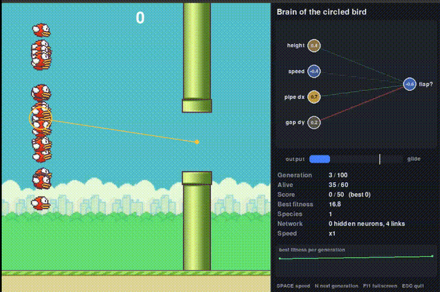

# AI_FLAPPY_BIRDS



A Flappy Bird project built with Python and pygame, in two parts:

1. **Play it yourself** – a complete Flappy Bird clone: click to flap, animated bird, procedurally spawned pipes, scoring, and a restart screen.
2. **Watch an AI learn it** – a population of birds is trained with **NEAT** (NeuroEvolution of Augmenting Topologies) using [`neat-python`](https://neat-python.readthedocs.io/). Each bird is flown by a small neural network, and a live side panel shows the "brain" of one bird, the decision it is making, and training progress.

## 🧠 How the AI works

Every bird in a generation gets its own neural network. On every frame the network looks at the game, decides whether to flap, and the bird is rewarded for surviving. The best birds breed the next generation, and NEAT can add neurons and connections over time, so the networks grow more complex as they learn.

**Inputs (4)**, all scaled to roughly -1 … 1:

| Input    | Meaning                                                 |
| -------- | ------------------------------------------------------- |
| `height` | The bird's vertical position on screen                  |
| `speed`  | The bird's current vertical velocity                    |
| `pipe dx`| Horizontal distance to the next pipe                    |
| `gap dy` | Vertical distance from the bird to the centre of the gap|

**Output (1):** if the value is greater than `0.5`, the bird flaps.

**Fitness:**

- `+0.1` for every frame a bird stays alive
- `+5` for every pipe the flock passes

A bird dies when it hits a pipe, the ground, or the top of the screen.

**Training stops** when a bird passes **50 pipes** (`SCORE_LIMIT`) or after **100 generations** (`MAX_GENERATIONS`). When the score limit is reached, the best bird is shown flying on its own, restarting automatically whenever it crashes.

The best genome is saved to `best_genome.pkl` every time a new best fitness is found, so you can watch the champion later without retraining.

## 📁 What's Inside

| Path                      | Content                                                                                                                                                |
| ------------------------- | ------------------------------------------------------------------------------------------------------------------------------------------------------ |
| `flappy_birds.py`         | Human-playable game. Main `Game` class: window setup, game loop, spawning/scrolling pipes, scoring, collision detection, and the game-over/restart flow |
| `ai_flappy.py`            | AI mode. Runs NEAT training, draws the game plus the side panel, and can replay the saved champion (`--play`)                                           |
| `config-feedforward.txt`  | NEAT settings: population size, mutation rates, network shape, speciation, etc.                                                                         |
| `best_genome.pkl`         | The best bird found so far, saved automatically during training                                                                                        |
| `scripts/bird.py`         | `Bird` sprite for human play: gravity, click-to-flap, a 3-frame flap animation, and sprite rotation based on velocity                                   |
| `scripts/ai_bird.py`      | `AIBird` sprite for AI mode: a bird that carries its own genome, network, fitness, and latest output                                                   |
| `scripts/pipe.py`         | `Pipe` sprite: a single top or bottom pipe that scrolls left and removes itself once off-screen                                                         |
| `scripts/button.py`       | A small reusable `Button` class, used for the restart button on the game-over screen                                                                    |
| `scripts/neat_view.py`    | Drawing helpers for the side panel: the live network view, the decision gauge, and the fitness chart                                                    |
| `data/img/`               | Art assets (see below)                                                                                                                                  |

### `data/img/` assets

| File                                  | Used for                                                                                                                                                                |
| ------------------------------------- | ----------------------------------------------------------------------------------------------------------------------------------------------------------------------- |
| `bg.png`                              | Background                                                                                                                                                              |
| `ground.png`                          | Scrolling floor strip                                                                                                                                                   |
| `bird1.png`, `bird2.png`, `bird3.png` | Flap animation frames                                                                                                                                                   |
| `pipe.png`                            | Pipe sprite (flipped for the top pipe)                                                                                                                                  |
| `restart.png`                         | Restart button on the game-over screen                                                                                                                                  |
| `bglong.png`, `spritesheet.png`       | Not currently loaded by the code. Likely reserved for a future revision (e.g. a longer scrolling background, or a single sprite sheet instead of separate bird frames) |

## ⚙️ Requirements

- Python 3
- [pygame](https://www.pygame.org/)
- [neat-python](https://neat-python.readthedocs.io/) (only needed for AI mode)

```
pip install pygame neat-python
```

## 🚀 Running

Run everything from inside the project folder, because assets are loaded with paths relative to it (`./data/img/...`):

```
git clone https://github.com/egorchimacovschi/ai_flappy_birds.git
cd ai_flappy_birds
```

**Play the game yourself**

```
python3 flappy_birds.py
```

**Train the AI** (opens a window and shows training live)

```
python3 ai_flappy.py
```

**Watch the saved champion** (loads `best_genome.pkl`, no training)

```
python3 ai_flappy.py --play
```

## 🎮 Controls

### Human mode (`flappy_birds.py`)

| Input            | Action                                          |
| ---------------- | ----------------------------------------------- |
| Left mouse click | Flap / start the game / restart after game over |

### AI mode (`ai_flappy.py`)

| Key   | Action                                                        |
| ----- | ------------------------------------------------------------- |
| `SPACE` | Cycle simulation speed: x1 → x5 → x20                       |
| `N`   | Skip to the next generation (kills all birds that are still alive) |
| `F11` | Toggle fullscreen                                             |
| `ESC` | Quit                                                          |

## 📊 The side panel

In AI mode the window has an extra panel on the right. It follows one living bird (circled in the game view, with a line to the centre of the next pipe gap) and shows:

- **Brain of the circled bird**: its network drawn live, with the four inputs on one side and the flap decision on the other
- **Decision gauge**: how strongly the network wants to flap right now
- **Training stats**: generation, birds alive, score (and best score), best fitness, number of species, hidden neurons and links in the network, and current speed
- **Fitness chart**: best fitness per generation

## 🔧 Tuning the training

The NEAT settings live in `config-feedforward.txt`. The ones most worth changing are marked with `<--` in the file:

| Setting          | Effect                                                         |
| ---------------- | -------------------------------------------------------------- |
| `pop_size`       | Number of birds per generation (default 60)                    |
| `node_add_prob`  | Higher values make more hidden neurons appear                  |
| `conn_delete_prob` | Lower values keep more connections, so the network looks fuller |

`SCORE_LIMIT` and `MAX_GENERATIONS` are constants at the top of `ai_flappy.py`.

## 📌 Notes

- Human mode: the score increases by 1 each time the bird fully passes a pipe. The game ends if the bird hits a pipe, the ground, or the top of the screen, and clicking the restart button resets the bird, pipes, and score.
- If training runs for all 100 generations without any bird reaching the score limit, the script finishes without replaying a champion. Run it again, or raise `MAX_GENERATIONS`.
- Training is random, so each run learns differently. Some runs solve the game in a few generations, others take longer.x   x   